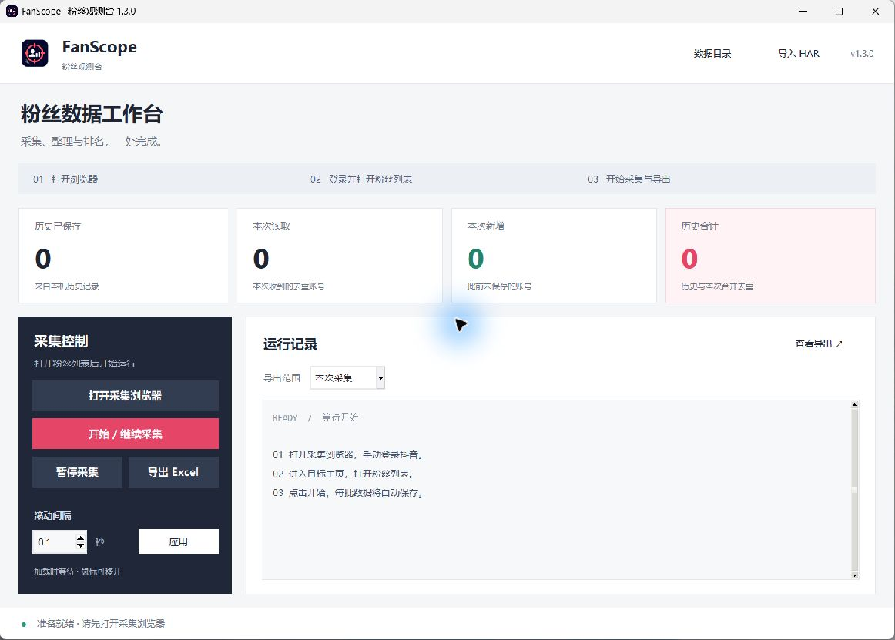

<p align="center"></p>
<h1 align="center">FanScope · 粉丝观测台</h1>
<p align="center">本地粉丝列表采集、HAR 整理与 Excel 排名工具</p>
<p align="center">
  <a href="https://github.com/JahsehXL/FanScope/actions/workflows/check.yml"></a>
  <a href="https://github.com/JahsehXL/FanScope/releases"></a>
  <a href="LICENSE"></a>
</p>

FanScope 使用专用 Edge 会话，保存网页实际收到的抖音粉丝列表响应。也可以离线导入已有 HAR，按 UID 去重，并按每位粉丝自身的粉丝数量导出 Excel。

## 先找到你要的文件

| 你要做什么 | 位置 |
| --- | --- |
| 直接打开本地软件 | 双击根目录 **打开软件.cmd**，或运行 `app/FanScope.exe` |
| 从 GitHub 下载软件 | [下载 Windows 发行版](https://github.com/JahsehXL/FanScope/releases/latest)，解压后运行其中的 `FanScope.exe` |
| 看核心源代码 | [src/collector.py](src/collector.py)，包含采集、数据处理和桌面界面 |
| 运行或修改源码 | 双击 **运行源码.cmd**，开发命令见下文 |
| 看测试和构建流程 | [tests](tests) 和 [scripts](scripts) |
| 看隐私说明和更新记录 | [docs](docs) |

GitHub 提供可审查的源码，编译后的 Windows 程序通过 Releases 分发。本地项目统一使用 `app/` 放置最新版 EXE。构建脚本会自动更新这个位置，历史版本安装包保存在 `dist/`。

```text
FanScope/
  打开软件.cmd             双击打开 app 中的软件
  运行源码.cmd             建立环境并运行源码
  app/                     本地最新版 EXE 与使用入口
    FanScope.exe           本地构建或下载后放在这里
  src/                     软件源代码（.py）
    collector.py           主程序、采集逻辑与桌面界面
    packaging_smoke.py     打包后的自检逻辑
  tests/                   自动化测试
  scripts/                 构建与模拟采集检查脚本
  docs/                    隐私说明、更新记录
  assets/                  图标、截图、字体许可
  .github/                 GitHub 工作流与贡献、安全说明
  dist/                    本地版本安装包（构建生成）
  work/                    本地构建缓存、检查记录和历史归档
```

## 本地处理与网络行为

粉丝去重、数量排序、HAR 解析和 Excel 生成均在本机执行。采集批次、表格和专用浏览器登录状态保存在当前 Windows 用户的应用数据目录。项目代码未实现向维护者服务器自动上传粉丝数据、HAR 或 Cookie 的功能，也未集成遥测和自动更新服务。

| 操作 | 处理位置与联网情况 |
| --- | --- |
| 导入已有 HAR、去重、排名、导出 Excel | 本机文件与内存处理，可在断网状态下运行 |
| 打开采集浏览器、登录、加载粉丝列表 | 真实 Edge 访问抖音及网页资源，需要网络 |
| 源码首次安装依赖 | 从所配置的 Python 软件源下载依赖，需要网络 |
| 点击表格内的抖音主页链接 | 由用户打开的浏览器访问对应网页，需要网络 |

浏览器会按网页逻辑发送请求和登录凭据。专用配置目录中的登录状态以及本机 HAR、表格仍应妥善保管。当前回归测试在禁止 Python 创建网络套接字的条件下验证 HAR 导入和 Excel 导出，详细数据说明见 [PRIVACY.md](docs/PRIVACY.md)。

## 浏览器会话与访问限制

采集使用电脑上安装的真实 Edge，由用户手动登录，并使用 FanScope 的独立配置目录保存 Cookie 和本地存储。这使采集会话与日常浏览配置分开。持久化目录的作用和边界可查阅 [Playwright 文档](https://playwright.dev/python/docs/api/class-browsertype#browser-type-launch-persistent-context)。

工具等待正在加载的粉丝请求完成，并对可识别的验证提示、HTTP 错误及长时间无新响应暂停处理。上述机制提供请求调度和受限时停止操作的能力。平台仍会收到采集浏览器的请求与登录会话，自动化访问可能触发验证或限制。当前项目尚未测量风控触发率，模拟测试验证的是采集与导出的正确性。使用时仍需遵守 [平台规则](https://www.douyin.com/draft/douyin_agreement/douyin_agreement_user.html?id=6773906068725565448)。



**实验性项目。运行前请确认你对目标数据的处理具有适当授权，并遵守适用法律和平台协议。** 平台协议对自动化收集有明确限制，软件许可与数据使用授权需要分别确认。请阅读 [使用边界与数据说明](docs/PRIVACY.md)。

## 下载

在 [Releases](https://github.com/JahsehXL/FanScope/releases/latest) 下载 `FanScope-版本-Windows-x64.zip`，解压后双击 `FanScope.exe`。

- Windows 10/11 64 位，已安装 Microsoft Edge。
- EXE 已包含 Python 与依赖。压缩包约 59 MB，主要体积来自 Playwright 的 Node.js 驱动，另含界面控件、Pillow 和字体资源。
- 发布文件附带 SHA-256 校验值。当前版本尚未配置代码签名。

## 功能

- 深色桌面工作台，左侧工作区导航、顶部采集操作、独立日志与导出设置。
- 手动登录，自动识别粉丝列表并滚动，鼠标可移开。
- 每批数据原子写入本机，按目标账号分目录、按 UID 去重。
- 分别显示历史数量、本次读取数量、新增数量和历史合计。
- 按启动时的系统 DPI 缩放字体和控件，窗口初始大小适配桌面工作区。
- 窄窗口统计卡片切换为两列，操作区在更窄时上下排列，低高度窗口可滚动访问全部操作。
- 导出范围可选 **本次采集** 或 **历史合并**，默认本次采集。
- 接口返回末页后自动导出，也可手动暂停或导出。
- 支持 `.har` 与 `.har.devtools` 离线导入。
- 对可识别的验证码提示、访问受限提示、请求错误及长时间无新响应暂停处理。
- 仅保存指定字段，完整 HTTP 请求头和响应中的其他字段不会写入新批次。

## 使用

1. 打开 FanScope，点击 **打开采集浏览器**。
2. 在新 Edge 窗口手动登录，进入目标主页并打开粉丝列表。
3. 回到工具，点击 **开始 / 继续采集**。
4. 选择导出范围，等待末页自动导出，或点击 **导出 Excel**。
5. 点击 **查看导出** 打开表格，点击 **数据目录** 查看保存位置。

默认滚动间隔为 0.1 秒，范围 0.05～10 秒。间隔是滚动调度时间，实际请求速度受页面与接口响应影响。该数值不代表平台公布的安全阈值。

定位失败时，将鼠标移到列表内部一次后重试。列表已在末尾时，可关闭后重新打开列表。验证和登录由本人处理，处理完成后再手动继续。

## 数量与导出范围

| 指标 | 含义 |
| --- | --- |
| 历史已保存 | 当前目标账号从本机恢复的去重数量 |
| 本次读取 | 本次工具会话中，当前目标账号实际收到的去重数量 |
| 本次新增 | 本次读取中，此前未保存的账号数量 |
| 历史合计 | 历史和本次数据合并后的去重数量 |

**本次采集**只导出本次实际收到的账号。**历史合并**可能保留已取关的账号，不能直接当作当前粉丝名单。切换目标账号后，本次统计重新开始。

字段包含昵称、粉丝数、抖音号、关注数、作品数、获赞数、备注名、UID、主页链接和简介。同粉丝数并列排名，缺失数量排在末尾并留空。

## 本机数据

默认目录为运行者电脑上的 `%LOCALAPPDATA%\FanScope`，由当前用户环境动态生成。Edge 通过 Playwright 的 `msedge` 通道定位本机安装，图标从程序自带资源中读取。

```text
FanScope/
  browser-profile/       专用 Edge 登录状态
  data/
    <目标账号标识的哈希>/
      batch-000001.json  经过字段筛选的采集批次
      FanScope-*.xlsx    导出表格
```

可以通过环境变量 `FANSCOPE_HOME` 指定其他数据目录，支持环境变量和 `~` 展开。相对路径在启动时以当前工作目录解析并固定为绝对路径，后续文件对话框或工作目录变化不会改变写入位置。源码版和 EXE 使用同一默认位置。查看、备份和删除数据前，请先退出工具，再在自己的文件管理器中处理对应文件。

HAR 可能包含登录凭据及其他个人信息，请保存在自己的设备上。发布 Issue 时仅提供脱敏错误信息和复现步骤。

## 从源码运行

需要 Python 3.12，命令在项目根目录执行。

```powershell
python -m venv .venv
.\.venv\Scripts\python.exe -m pip install -r requirements.txt
.\.venv\Scripts\python.exe src/collector.py
```

Windows 也可双击 `运行源码.cmd`，首次会在项目内创建虚拟环境并安装依赖。

离线导入示例。

```powershell
.\.venv\Scripts\python.exe src/collector.py --import-har "example.har" --data-dir ".\local-data"
```

CLI 导入默认导出历史合并范围。GUI 导入使用界面所选范围。一个 HAR 请只包含一个目标账号，多账号文件会报错，已经读取的批次仍保存在本机。

## 验证与打包

```powershell
.\.venv\Scripts\python.exe -m pip install -r requirements-dev.txt
.\.venv\Scripts\python.exe -m unittest tests.test_fanscope tests.test_ui -v
.\.venv\Scripts\python.exe scripts/verify_collector.py
.\.venv\Scripts\python.exe scripts/build_exe.py
```

构建完成后，最新版软件位于 `app/FanScope.exe`，版本安装包位于 `dist/v版本号/`，构建与检查记录位于 `work/`。`FanScope.exe --diagnose <测试输出目录>` 可以检查打包后的界面、Edge 驱动、模拟网络采集和 Excel 导出。模拟验证会拦截全部浏览器请求，使用虚构账号。

界面使用 CustomTkinter 和 Pillow，构建脚本显式收集主题、字体资源及第三方许可证。发布使用单文件 EXE，并通过打包后的自检确认资源可以正常加载。

界面视觉参考了 [Linear 的侧栏层次](https://linear.app/now/behind-the-latest-design-refresh) 和 [Raycast 的操作分组](https://www.raycast.com/blog/a-fresh-look-and-feel)，使用代码重新实现。

布局回归覆盖 100%、125%、150%、200% 的 Tk 缩放模拟及多种窗口尺寸。实际桌面检查使用 125% 系统缩放。不同缩放比例的显示器之间移动窗口时，显示效果仍受 Windows 与 Tk 的系统 DPI 模式影响。

## 已知限制

- 适配抖音网页 `follower/list` 响应，页面结构或接口字段改变后可能需要更新。
- 网页接口返回数量可能小于页面显示总数，首批与末页标记不能证明覆盖全部粉丝。
- 验证页面识别依赖可见 DOM 特征，无法覆盖所有风控形式，也无法保证账号安全。
- 保存记录恢复与 UID 合并已实现，重启后的可靠游标续采仍待实现，通常需要重新打开列表滚动。
- 数值来自采集时的接口响应，历史合并包含不同时刻的数据。
- 旧版批次可读取，历史文件中的原始内容保留在原文件内；读取时仅使用允许字段。

## 贡献

欢迎提交页面适配、数据准确性、隐私最小化和界面改进。贡献方式见 [CONTRIBUTING.md](.github/CONTRIBUTING.md)，安全问题见 [SECURITY.md](.github/SECURITY.md)。

## License

[MIT](LICENSE)。第三方依赖保留各自许可证，发布包附带第三方许可文本。图标由 OpenAI 图像生成工具生成，提示词及资源说明见 [assets/ICON_PROMPT.md](assets/ICON_PROMPT.md)。

## English summary

FanScope is an experimental Windows desktop tool for locally collecting visible Douyin follower-list responses, importing HAR files, deduplicating accounts, and exporting follower-count rankings to Excel. It supports current-session and merged-history exports. Login and verification are handled manually in a dedicated Edge profile. Data stays on your machine. Confirm applicable permissions, platform terms and legal requirements before use. See the Chinese documentation above for setup, data scope, limitations and reproducible builds.
